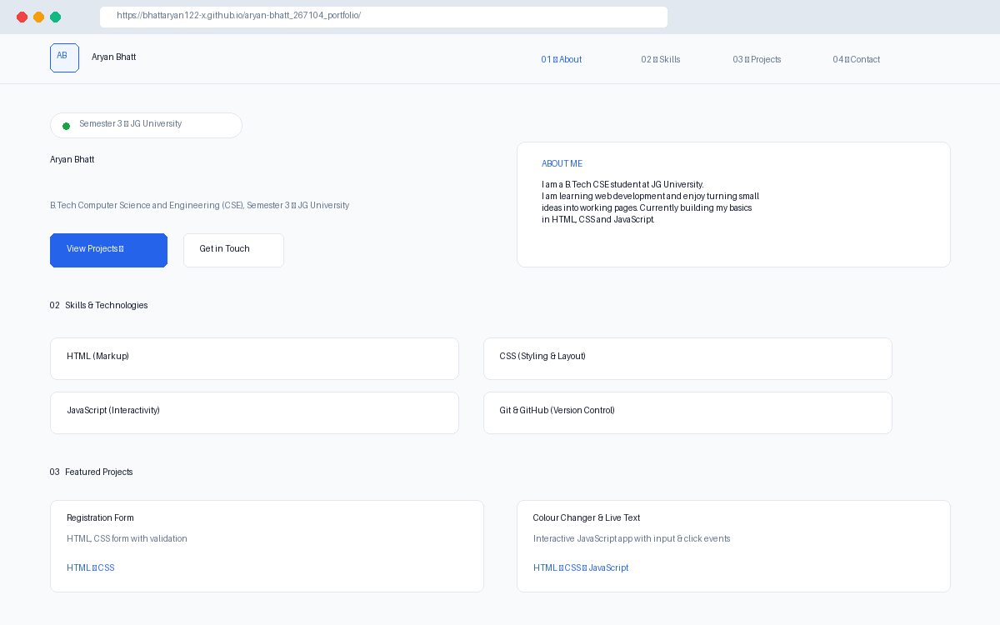

# Aryan Bhatt — Personal Portfolio

A sleek, modern digital personal portfolio website built as a college assignment for B.Tech Computer Science and Engineering (CSE), Semester 3 at JG University.

## Description

This portfolio presents my background, technical skills, academic projects, and contact information. Built with pure HTML5, CSS3, and vanilla JavaScript without any external libraries or frameworks, the site emphasizes clean semantic structure, responsive design, and a modern digital aesthetic with interactive features.

## Technologies Used

- HTML5 (Semantic elements, modern form controls, dialog modal)
- CSS3 (Variables, Flexbox, CSS Grid, Media Queries, animations)
- JavaScript (Vanilla ES6, Event Listeners, IntersectionObserver, Clipboard API)
- Git & GitHub (Version control)

# Screenshot

## Features

- **Modern Clean Theme**: Crisp slate canvas with electric blue accents and dark mode.
- **Scroll Progress Bar**: Real-time reading progress bar at the top of the page.
- **ScrollSpy Navigation**: Automatically highlights active navbar section as you scroll.
- **Interactive Project Demo**: Pop-up modal with a live working demo of the *Colour Changer and Live Text* project.
- **Dynamic Character Counter**: Live character counting on the contact message textarea.
- **One-Click Email Copy**: One-click clipboard copy button with visual feedback.
- **Back to Top Button**: Smooth floating button appearing on scroll.
- **Form Validation**: Strict client-side validation with real-time error removal.
- **Responsive Layout**: Optimized for mobile, tablet, and desktop screens.

## Live Link

Live link: https://bhattaryan122-x.github.io/aryan-bhatt_267104_portfolio/
